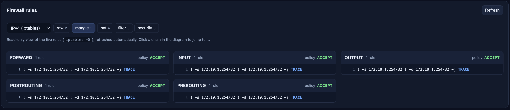

# PacketMan

**Visualize `iptables` rules, network interface traffic, and packet flow in real time.**


PacketMan reads netfilter trace events from `xtables-monitor` and shows each packet's path through your network interfaces and `iptables` chains in a browser. Every hop lights up green if the packet was accepted and red if it was dropped.

Examples can be seen here: [Examples](examples/)

## Features

- **Live flow diagram:** packets are drawn across your network interfaces and the `raw`, `mangle`, `nat`, `filter` and `security` chains, with a green or red glow for each accept or drop.
- **Automatic interface discovery:** interfaces are detected on startup and as they are added or removed.
- **Current rules at a glance:** view the live rules for every table and chain, so you can check each trace against the rules that produced it.
- **Per-packet detail:** expand any packet to see the exact chain-by-chain trace.

### Validate packet flow against your current rules



### Inspect chain-by-chain packet flow


## Installation

Download the `packetman` package from the [releases](https://github.com/IanGluesing/PacketMan/releases) page, or build it locally by running `generated_build.sh`. Locally built artifacts are written to the `examples` folder.

Install the package:

```
bash-5.1# rpm -Uvh /path/packetman-<version>.aarch64.rpm
```

## Usage

Start PacketMan (root is required to read netfilter traces):

```
bash-5.1# packetman
iptables trace viewer listening on http://0.0.0.0:8000
```

Then open `http://localhost:8000` in a browser on the device running PacketMan.

## Enabling traces

PacketMan displays packets that match a `TRACE` rule, so add trace rules to the chains you want to observe. The following covers every table and chain; choose the subset that is most useful for your use case, since tracing generates a lot of events on busy systems.

```
declare -A chains=(
  [raw]="PREROUTING OUTPUT"
  [mangle]="PREROUTING INPUT FORWARD OUTPUT POSTROUTING"
  [nat]="PREROUTING INPUT OUTPUT POSTROUTING"
  [filter]="INPUT FORWARD OUTPUT"
  [security]="INPUT FORWARD OUTPUT"
)

for table in "${!chains[@]}"; do
  for chain in ${chains[$table]}; do
    iptables-nft -t "$table" -I "$chain" 1 -j TRACE
  done
done
```

To remove the trace rules, run the same loop with `-D "$chain" -j TRACE` in place of `-I "$chain" 1 -j TRACE`.