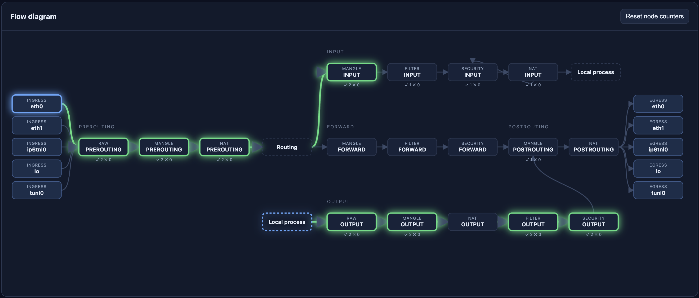

# PacketMan

Easily visualize `iptables` rules, network interface traffic, and packet flow with `PacketMan`!



Requires: `xtables-monitor`, `express`, `socket.io`

Running: `node app.js` and navigate to `localhost:8000`

The following basic rules can be applied, it is up to the user to determine the most impactful chain traces for their use case.

```
# Add trace for raw table
iptables-nft -t raw -I OUTPUT 1 -j TRACE
iptables-nft -t raw -I PREROUTING 1 -j TRACE

# Add trace for filter table
iptables-nft -t filter -I INPUT 1 -j TRACE
iptables-nft -t filter -I FORWARD 1 -j TRACE
iptables-nft -t filter -I OUTPUT 1 -j TRACE

# Add trace for nat table
iptables-nft -t nat -I PREROUTING 1 -j TRACE
iptables-nft -t nat -I INPUT 1 -j TRACE
iptables-nft -t nat -I OUTPUT 1 -j TRACE
iptables-nft -t nat -I POSTROUTING 1 -j TRACE

# Add trace for mangle table
iptables-nft -t mangle -I PREROUTING 1 -j TRACE
iptables-nft -t mangle -I INPUT 1 -j TRACE
iptables-nft -t mangle -I FORWARD 1 -j TRACE
iptables-nft -t mangle -I OUTPUT 1 -j TRACE
iptables-nft -t mangle -I POSTROUTING 1 -j TRACE

# Add trace for security table
iptables-nft -t security -I INPUT 1 -j TRACE
iptables-nft -t security -I FORWARD 1 -j TRACE
iptables-nft -t security -I OUTPUT 1 -j TRACE
```