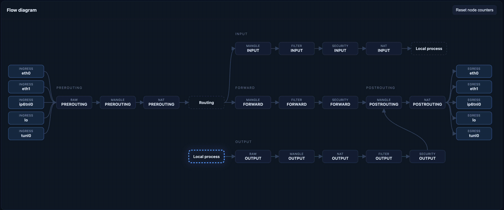
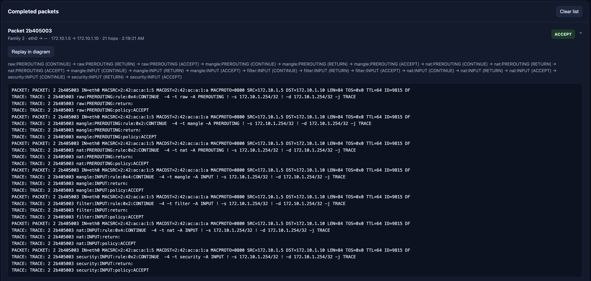
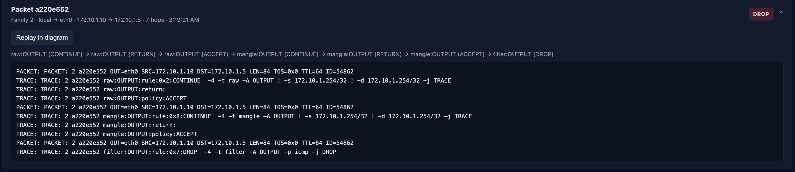

# Drop Outgoing Icmp Response

This will demo the iptables accepting an icmp request message, and then dropping the icmp response at the OUTPUT chain of the filter table.



In the `router` container, we will add a rule, `iptables-nft -t filter -I OUTPUT -p icmp -j DROP`, to drop outgoing icmp traffic in the OUTPUT chain of the filter table. To validate this we can do the following:

### 1. Launch the demo containers:

```
docker-compose up -d --build
```

The `router` container should start `packetman` on its entrypoint, navigate to `localhost:8080` in your browser.

### 2. Send a ping:

Verify there is no ping response

```
username@os# docker exec host-a bash -c "ping -c 1 172.10.1.10 -c 1 -w 1"
PING 172.10.1.10 (172.10.1.10) 56(84) bytes of data.

--- 172.10.1.10 ping statistics ---
1 packets transmitted, 0 received, 100% packet loss, time 0ms

username@os#
```

### 3. Validate iptables traversal



### 4. Validate the response was dropped




This demonstrates that the incoming packet is accepted through all iptables, a response is then generated, and then dropped by the filter OUTPUT chain.

### 5. Stop the demo containers:


```
docker compose down -t 0
```